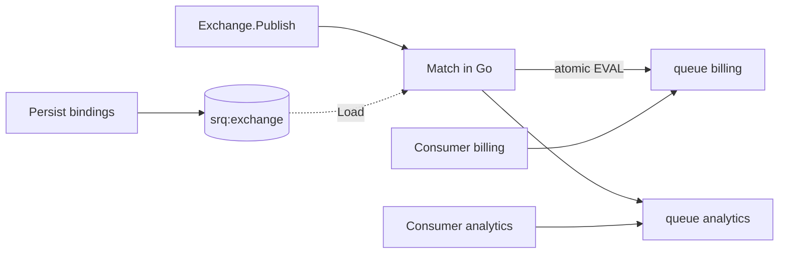

# Exchange (direct / fanout / topic)

Маршрутизация одного Publish в **несколько work-очередей** по bindings — близко к RabbitMQ exchange. Каждая dest-очередь получает **копию** задачи; дальше обычные competing consumers.

Это не Kafka consumer groups и не общий лог с offset: после Publish в каждой очереди свой payload и свой Ack.

Headers-exchange нет (headers на Publish пока не задаются). Тип exchange **не хранится в Redis** — это алгоритм матчинга на продюсере.

## Модель

| Kind | Routing key | Куда уходит |
|------|-------------|-------------|
| `ExchangeDirect` | точное совпадение с pattern | все очереди с этим pattern |
| `ExchangeFanout` | игнорируется | **все** bound очереди |
| `ExchangeTopic` | AMQP: `*` = один сегмент, `#` = ноль или больше (через `.`) | совпавшие pattern |

Bindings живут в Redis (`srq:exchange:{name}:bindings`) или только в памяти процесса. **Persist явный** — CI, init-container или admin-app. Старт Producer/Consumer bindings **не** перетирает.

Consumer подписывается на **стабильное имя очереди** из кода. Очереди ещё нет → Get пустой, sleep/poll; после первого Publish ключи появятся сами (EnsureQueue для exchange не нужен).



## Конфиг потоков (один раз)

```go
ex := redisqueue.NewExchange(rdb, "orders").
    Bind("order.created", "billing").
    Bind("order.created", "analytics").
    Bind("order.*.eu", "eu-workers").
    Bind("", "audit-all") // для Fanout: любая привязка попадает в список
if err := ex.Persist(ctx); err != nil {
    return err
}
```

`Persist` перезаписывает HASH bindings и делает `INCR` версии. Продюсеры в рантайме вызывают `Load`, не `Persist`.

## Продюсер

```go
ex := redisqueue.NewExchange(rdb, "orders")
if err := ex.Load(ctx); err != nil {
    return err
}

err := ex.Publish(ctx, redisqueue.ExchangeTopic, "order.paid.eu",
    &redisqueue.Task{
        ID:        "t1",
        Partition: "cust-42",
        Payload:   payload,
    },
)
```

Пустой match → `ErrNoRoute`.

Один и тот же `Task.ID` уходит во все dest (ключи разведены `queue:{q}:payload:{id}`) — удобно для трейсинга. Idempotency — **per-queue**.

### Доставка

| Режим | Поведение |
|-------|-----------|
| **Atomic** (default) | Один EVAL: копии во все dest атомарно |
| `WithDeliveryBestEffort()` | N× обычный Publish; при сбое mid-flight возможны частичные копии |
| `WithCheckVersion()` | В EVAL уходит ver; при смене Persist → Load, rematch, retry. Без флага **нет** `GET` ver на hot path |

Статичные bindings (деплой + `Load`) — atomic без `WithCheckVersion`. Динамическая смена потоков без рестарта продюсеров — `WithCheckVersion()`.

```go
_ = ex.PublishWith(ctx, redisqueue.ExchangeFanout, "",
    []redisqueue.ExchangePublishOption{redisqueue.WithCheckVersion()},
    &redisqueue.Task{ID: "n1", Payload: body},
)
```

In-memory only (тесты / один бинарь без Redis-конфига): `Bind` без `Persist`/`Load` — матч по локальному списку.

## Consumer

Без изменений — очередь из binding:

```go
c := redisqueue.NewConsumer(rdb, "billing")
return c.Consume(ctx, handler)
```

## Direct vs «сразу в очередь»

Direct нужен, когда продюсер **не должен знать** имена очередей: потоки настраивает отдельное приложение через `Persist`. Если dest один и известен — проще `Producer.Publish` в эту очередь без exchange.

## Ключи

| Ключ | Назначение |
|------|------------|
| `srq:exchange:{name}:bindings` | HASH field = pattern + sep + queue |
| `srq:exchange:{name}:ver` | версия; читается только при `WithCheckVersion` |

См. [Ключи Redis](../reference/redis-keys.md).
