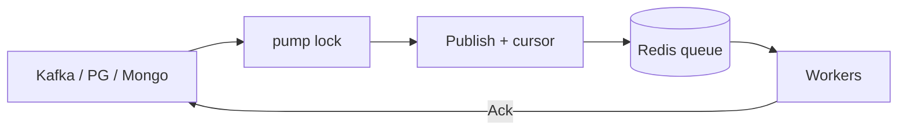

# Journal

Внешнее хранилище (Kafka / Postgres / Mongo) — источник правды о принятой работе. Redis остаётся планировщиком: партиции, локи, rate limit.

Пакеты подключаются отдельно:

```text
github.com/Rinsvent/smart-redis-queue/journal
github.com/Rinsvent/smart-redis-queue/journal/kafka
github.com/Rinsvent/smart-redis-queue/journal/pg
github.com/Rinsvent/smart-redis-queue/journal/mongo
```

## Как это работает

1. Пишете задачу в journal → получаете монотонный **offset** (Kafka offset, `BIGSERIAL`, Mongo `_id` / ObjectID).
2. Один **pump** (Bridge): берёт Redis-lock → читает батч после курсора → `PublishWith(WithJournal(...))` в очередь и двигает курсор в том же Lua.
3. В journal нет флага «уже прочитали». Есть только **ack обработки** (`acked_at` или ack-топик).
4. После SRQ `Ack` вызываете journal `Ack` (через `Consumer.SetJournalAck`).



Курсор: `srq:journal:{name}:cursor` — последний успешно уложенный в Redis offset.

## Почему offset, а не время

Два продюсера или долгая подготовка записи: более «поздний» батч может попасть в Redis раньше. Курсор по `scheduled` уедет вперёд — опоздавшее сообщение навсегда пропустится.

Между независимыми продюсерами порядок и в Redis не обещан. Ось журнала — порядок append, как в Kafka.

| Источник | Offset |
|----------|--------|
| kafka | partition + offset |
| pg | `BIGSERIAL` |
| mongo | `_id` (ObjectID) |

`scheduled` в journal пишется как передали (в том числе в прошлом). Zero → `now` при insert — это default «без плана», не подмена уже заданной даты.

Отложенное далеко в будущее лучше держать **вне** main offset-stream (отдельная таблица / mover → insert с новым offset, когда due). Иначе pump упрётся в ещё не due строку. Для Kafka far-schedule обычно нужен dual store (например pg).

## Pump lock

Один writer на журнал для всех драйверов:

- `srq:journal:{name}:pump` — `SET NX`, TTL ~60s, refresh ~10s;
- Redis поднялся, ключа нет — любой инстанс берёт лок и качает.

Ack обработки — с любых инстансов, без этого лока.

## Publish и rewind

`WithJournal(name, cursor)` идёт в тот же `publishLocal`, что и обычный Publish (compression, backpressure — там же). Новый cursor должен быть строго больше текущего, иначе `ErrJournalCursorRewind`. Повтор тех же task id → NX skip.

```go
prod.PublishWith(ctx, []redisqueue.PublishOption{
    redisqueue.WithJournal("orders", lastCursor.Encode()),
}, tasks...)
```

В payload можно класть только ссылку на offset; тело читать в handler через `ReadByOffset`.

## Совместимость с другими фичами

| Фича | Как стыкуется |
|------|----------------|
| compression / tag backpressure | Обычные `PublishOption` рядом с `WithJournal` |
| groups / partitions / RL / `race!` | После Publish в Redis — как у любой задачи |
| Exchange | Journal → work-очередь. Fan-out через Exchange — отдельный шаг, не вместо journal |
| Шардинг | Курсор и pump-lock живут на **том же** Redis, куда пишется батч. Батч с `WithJournal` не может уехать на несколько шардов сразу — будет ошибка. Либо очередь на одном шарде (`ShardByQueue` / отдельный инстанс), либо `WithShardName` / `SetPublishOptions` и клиент Bridge = этот шард |
| Emergency | `SetEmergencyResume` + `srq:resume_after` после `RecoverAfterRedis` |

## Recovery

После восстановления Redis:

1. Воркеры с `SetEmergencyResume` ждут `resume_after`.
2. Bridge берёт pump lock, при необходимости дожидается journal-ack.
3. Для Kafka: Lock done-id из ack-топика, затем pump с курсора.
4. Для PG/Mongo: pump с курсора, только `acked_at IS NULL` (отдельный Lock не нужен).
5. Режим auto — Bridge сам ставит `resume_after`.

Между SRQ Ack и journal Ack возможны дубли (at-least-once). Прямой Publish в Redis без journal это не закрывает.

## Схема PG

Имя таблицы — в конфиге (по умолчанию `srq_journal_tasks`):

```sql
CREATE TABLE srq_journal_tasks (
    journal_offset BIGSERIAL PRIMARY KEY,
    task_id    TEXT NOT NULL UNIQUE,
    partition  TEXT NOT NULL DEFAULT '',
    priority   INT NOT NULL DEFAULT 0,
    payload    BYTEA NOT NULL,
    tags       TEXT[] NOT NULL DEFAULT '{}',
    groups     TEXT[] NOT NULL DEFAULT '{}',
    scheduled  TIMESTAMPTZ NOT NULL DEFAULT NOW(),
    created_at TIMESTAMPTZ NOT NULL DEFAULT NOW(),
    acked_at   TIMESTAMPTZ
);

CREATE INDEX idx_srq_journal_due
    ON srq_journal_tasks (scheduled)
    WHERE acked_at IS NULL;
```

Mongo: `_id` = ObjectID (курсор = hex), unique `task_id`, insert пачкой (`InsertMany`). Ack: `acked_at` (null до Ack).

## API (кратко)

```go
src, _ := pg.New(ctx, pg.Config{DSN: dsn})
_ = src.Init(ctx)

br := journal.NewBridge(rdb, "orders", "orders-q", src)
// br.SetPublishOptions(redisqueue.WithCompression(...))
go br.Loop(ctx, 64, 200*time.Millisecond)

consumer.SetJournalAck(func(ctx context.Context, id string) error {
    return src.Ack(ctx, id, nil)
})
consumer.SetEmergencyResume(true)
```

`docker-compose`: Redis, Postgres, MongoDB, Kafka. Интеграционные тесты драйверов сами skip'аются, если сервис недоступен.

См. также: [delivery](../delivery.md#redis-persist) · [api](../reference/api.md) · [redis-keys](../reference/redis-keys.md)
