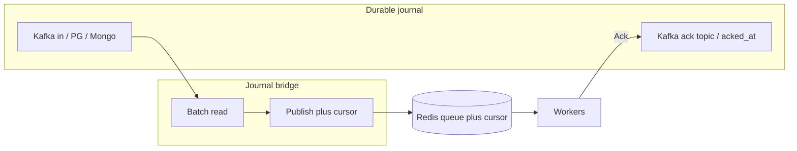
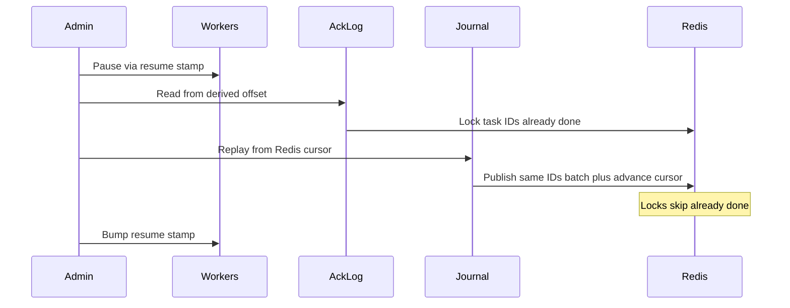

# Journal (durable ingress + recovery)

Журнал снаружи Redis — **источник правды о принятой работе**. Redis остаётся планировщиком: миллионы логических партиций, локи, rate limit. Так убирается окно потери `appendfsync everysec` на этапе «работу приняли», и появляется контролируемый recovery после аварии Redis.

Драйверы — **отдельные пакеты** (бинарь растёт только если их импортировать):

```text
github.com/Rinsvent/smart-redis-queue/journal          # интерфейсы
github.com/Rinsvent/smart-redis-queue/journal/kafka
github.com/Rinsvent/smart-redis-queue/journal/pg
github.com/Rinsvent/smart-redis-queue/journal/mongo
```

## Идея потока



1. **Batch-чтение** журнала → `Publish` в SRQ.
2. Курсор журнала в Redis двигается **только вместе с успешным Publish** батча (атомарно). Не передали в Redis → курсор не двигаем.
3. В источнике **не** ставим флаг «прочитано» (лишняя работа и рассинхрон). Фиксируем только **обработку** (ack).
4. После успешного SRQ `Ack` воркер пишет ack в журнал: PG/Mongo — `acked_at`; Kafka — сообщение с `task_id` в **ack-топик**.

Почему нельзя «просто коммитить Kafka consumer offset после Ack»: задача может часами лежать в Redis (другая логическая партиция заблокирована лимитом), а физическая партиция Kafka уже ушла бы вперёд или, наоборот, offset не двигался бы и копились бы дубли/блокировки. Курсор «что уже в Redis» живёт в Redis; ack «что уже сделано» — отдельно.

## Курсор в Redis

| Свойство | Правило |
|----------|---------|
| Где | ключ на очередь/журнал, например `srq:journal:{name}:cursor` |
| Когда | после успешного batch Publish |
| Монотонность | только вперёд; батч фиксирует **последний** курсор батча |
| Нагрузка | одно обновление на батч, не на каждое сообщение |

Эскиз (Publish батча + cursor в одном EVAL / MULTI):

```text
для каждой записи батча: add_tasks(...)
SET cursor = lastCursorInBatch   # только если все Publish OK
```

Если Publish батча упал посередине — курсор не двигаем; при повторе те же ID → `SET NX` / idempotency.

## Ack по драйверам

| Драйвер | Как фиксируем done | Чистка |
|---------|-------------------|--------|
| **pg** / **mongo** | `UPDATE … SET acked_at = now() WHERE id = $task_id` | TTL / partial index / TTL index |
| **kafka** | produce `{task_id, …}` в **ack-топик** | retention топика |

В Kafka **нельзя** дописать header в уже записанное сообщение in-топика — нужен отдельный ack-поток (топик). Out с полным ответом — опциональный audit для downstream; для recovery достаточно ack-топика с id.

## Recovery



1. Поставить воркеры на паузу (см. [Emergency mode](#emergency-mode)).
2. По Redis-курсору журнала оценить время / позицию.
3. **Kafka:** найти в ack-топике offset «с этого времени» → прочитать ack’и → `Producer.Lock(taskID)` (или аналог) в Redis.
4. **PG/Mongo:** выбрать `acked_at IS NOT NULL` в нужном окне → Lock тех же id.
5. Перечитать journal **с курсора** батчами → Publish (залоченные id не выполнятся повторно).
6. Снять паузу (новый resume stamp).

Без предварительных локов replay снова поставит в очередь уже сделанную работу.

## Emergency mode {#emergency-mode}

Воркеры **не** должны сами разгребать очередь сразу после восстановления Redis из дампа / длительного outage, пока админ не закончил lock+replay.

Механика (эскиз):

- В Redis ключ `srq:resume_after` = unix timestamp (или per-queue).
- При **подозрении на восстановление после потери состояния** (не при любом transient `i/o timeout`) воркер запоминает `faultAt` в памяти и **спит**, пока `resume_after <= faultAt` (или ключ отсутствует в «плохом» смысле — политика Init).
- Админ после recovery выставляет `resume_after = now()` (строго больше `faultAt` у живых процессов).
- Обычные краткие обрывы сети к живому Redis **не** включают этот режим (иначе ложные паузы). Точные эвристики (INFO loading, sync, явный admin flag) — в API драйвера/ядра при реализации.

## Rescheduler (далекое будущее)

Держать в Redis задачи «через годы» — раздувать память. Journal закладывает отложенный контур:

| Источник | Поведение |
|----------|-----------|
| **pg / mongo** | Записи со `scheduled`; poll «окно сейчас…+10s» → Publish в Redis заранее, без задержки на границе |
| **kafka** | В самом Kafka нет удобного «достать только due» без скана. **Не** плодим топики «+1h / +1d / +1y». Варианты: (1) в доке — limitation; far schedule через pg/mongo; (2) опциональный драйвер **scheduled-journal**: main journal + scheduled store, mover перекладывает due обратно в main / в Redis |

Порог «сразу в Redis vs в schedule store» (как ~1s в типичных outbox-схемах) — конфиг драйвера; для poll рекомендуем **окно +10s**, чтобы записи успели лечь в Redis до `scheduled`.

Батч: `SELECT … WHERE scheduled <= now()+10s AND acked_at IS NULL … FOR UPDATE SKIP LOCKED` / аналог в Mongo; Publish batch; без флага «прочитано» — курсор/состояние due определяется `scheduled` + отсутствием в Redis (NX) или лёгким `locked_at` на время publish (деталь реализации).

## API драйвера (эскиз)

```go
package journal

type Cursor string // opaque, монотонный для данного Source

type Record struct {
    Task   *redisqueue.Task
    Cursor Cursor
}

type Source interface {
    Init(ctx context.Context) error // топики / таблицы / индексы
    // ReadBatch — следующие записи после cursor (не «pending flag» в источнике).
    ReadBatch(ctx context.Context, after Cursor, n int) ([]Record, error)
    // Ack — обработка завершена (SRQ Ack OK).
    Ack(ctx context.Context, taskID string, meta map[string]string) error
    // ReadAcks — для recovery: ack’и с позиции/времени (kafka ack topic / SQL).
    ReadAcks(ctx context.Context, from Cursor, n int) ([]AckEvent, error)
}

type Bridge interface {
    // Перекладывает батч в Redis и атомарно двигает cursor в Redis.
    Pump(ctx context.Context, n int) error
    Cursor(ctx context.Context) (Cursor, error)
    ReplayFrom(ctx context.Context, from Cursor, n int) error
}
```

```go
import (
    redisqueue "github.com/Rinsvent/smart-redis-queue"
    "github.com/Rinsvent/smart-redis-queue/journal/kafka"
)

src, _ := kafka.New(kafka.Config{
    Brokers:  []string{"localhost:9092"},
    InTopic:  "jobs.in",
    AckTopic: "jobs.ack",
})
_ = src.Init(ctx)

bridge := journal.NewBridge(rdb, "jobs", src, producer)
go bridge.Loop(ctx) // ReadBatch → Publish+cursor

consumer.SetJournalAck(func(ctx context.Context, task *redisqueue.Task) error {
    return src.Ack(ctx, task.ID, nil)
})
```

`Init` — создать ack-топик / таблицу `tasks` / индексы при старте приложения (идемпотентно).

## Kafka: особенности

- In-топик для bridge обычно **одна физическая партиция** (или строго упорядоченный курсор на партицию — несколько cursor keys), иначе монотонный глобальный курсор сложнее.
- Payload в Redis можно заменить **offset-ref** (topic/partition/offset), полный body Fetch при Get — экономия RAM (паттерн драйвера, opt-in).
- Recovery ack-топика: от курсора/времени → offset в ack → Lock id до high watermark на момент старта recovery.

## Примеры SQL (pg)

```sql
CREATE TABLE journal_tasks (
    task_id    TEXT PRIMARY KEY,
    partition  TEXT NOT NULL DEFAULT '',
    payload    BYTEA NOT NULL,
    scheduled  TIMESTAMPTZ NOT NULL DEFAULT NOW(),
    created_at TIMESTAMPTZ NOT NULL DEFAULT NOW(),
    acked_at   TIMESTAMPTZ
);

CREATE INDEX idx_journal_due
    ON journal_tasks (scheduled)
    WHERE acked_at IS NULL;
```

Нет колонки `read_at`: факт «уже в Redis» = курсор bridge + идемпотентный Publish.

## Что не входит в v1

- Redpanda Connect как основной контур (в backlog: нативный output-драйвер Connect → Redis, без HTTP).
- Автоматический UI-wizard recovery (CLI/Admin API — да).
- Far-schedule на чистом Kafka без вторичного store.

## См. также

- [Гарантии доставки / Redis persist](../delivery.md#redis-persist)
- [API](../reference/api.md) (после реализации — секция Journal)
- [Ключи Redis](../reference/redis-keys.md)
