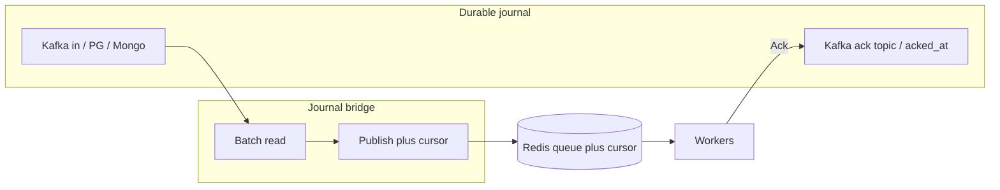
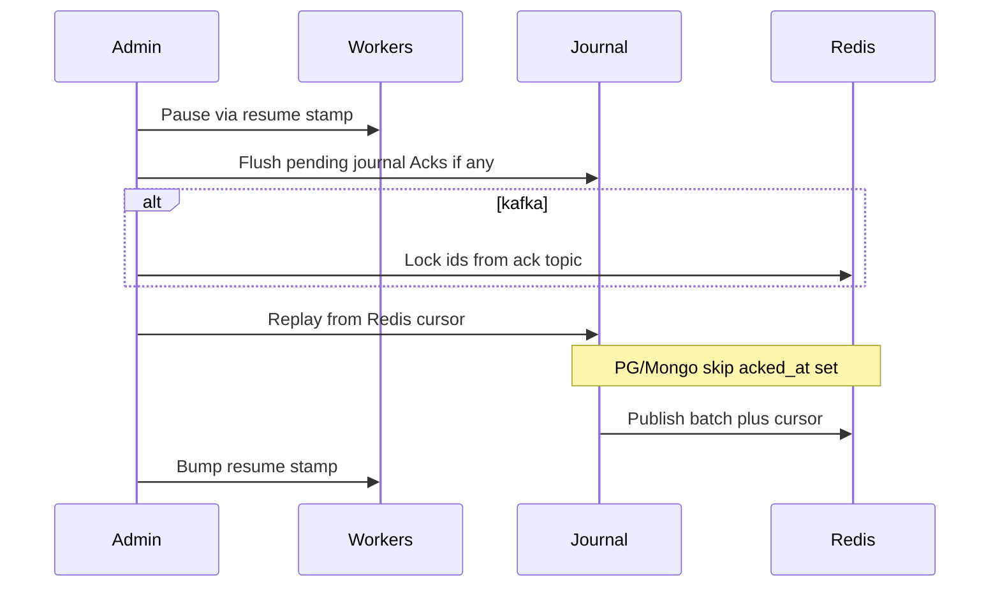
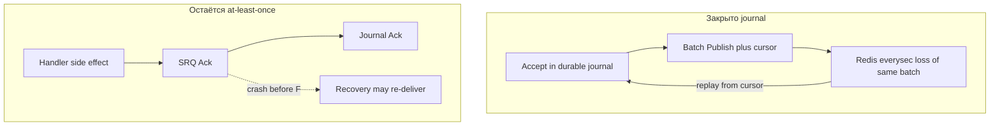

# Journal (durable ingress + recovery)

Журнал снаружи Redis — **источник правды о принятой работе**. Redis остаётся планировщиком: миллионы логических партиций, локи, rate limit. Ниже — модель, курсор, recovery и разбор, **какое окно потери реально закрывается**.

Драйверы — **отдельные пакеты** (бинарь растёт только если их импортировать):

```text
github.com/Rinsvent/smart-redis-queue/journal          # интерфейсы
github.com/Rinsvent/smart-redis-queue/journal/kafka
github.com/Rinsvent/smart-redis-queue/journal/pg
github.com/Rinsvent/smart-redis-queue/journal/mongo
```

## Идея потока



1. **Batch-чтение** журнала → `Publish` в SRQ.
2. Курсор в Redis двигается **только вместе с успешным Publish** батча (атомарно). Не передали в Redis → курсор не двигаем.
3. В источнике **не** ставим флаг «прочитано». Фиксируем только **обработку** (ack).
4. После успешного SRQ `Ack` воркер пишет ack в журнал: PG/Mongo — `acked_at`; Kafka — id в **ack-топик**.

Почему нельзя коммитить Kafka consumer offset «после Ack»: задача может часами лежать в Redis (логическая партиция на паузе), пока другие ключи обрабатываются. Offset «прочитано из Kafka» ≠ «сделано в SRQ». Курсор «уже в Redis» и ack «уже обработано» — разные оси.

## Курсор

| Источник | Форма курсора | Зачем |
|----------|---------------|--------|
| **pg / mongo** | пара `(scheduled, task_id)` | Порядок due + стабильный tie-break. `task_id` **монотонно растёт** (например UUIDv1 / ULID) — как требование к id в очереди для порядка. Иначе запись «на год вперёд», вставленная позже, при сортировке только по `created_at` / только по `scheduled` перепутает порядок относительно уже вычитанных. |
| **kafka** | `offset` (и partition, если курсоров несколько) | Нативный порядок лога |

В Redis хранится opaque/encoded cursor последнего **успешно опубликованного** батча: `srq:journal:{name}:cursor`.

Правила:

- монотонно вперёд;
- одно обновление на батч;
- Publish батча + `SET cursor` — одна атомарная операция (EVAL/MULTI). Упали посередине → курсор не двигаем → повтор с теми же id.

```text
ReadBatch WHERE (scheduled, task_id) > cursor
  ORDER BY scheduled, task_id
  LIMIT n
→ add_tasks для каждой
→ SET cursor = last (scheduled, task_id)
```

## Схема PG (и аналогично Mongo)

Все фичи очереди должны пройти через журнал — иначе bridge «обрежет» groups/tags/priority:

```sql
CREATE TABLE journal_tasks (
    task_id    TEXT PRIMARY KEY,           -- монотонный id (UUIDv1 / ULID / …)
    partition  TEXT NOT NULL DEFAULT '',
    priority   INT NOT NULL DEFAULT 0,
    payload    BYTEA NOT NULL,
    tags       TEXT[] NOT NULL DEFAULT '{}',
    groups     TEXT[] NOT NULL DEFAULT '{}',
    scheduled  TIMESTAMPTZ NOT NULL DEFAULT NOW(),
    created_at TIMESTAMPTZ NOT NULL DEFAULT NOW(),
    acked_at   TIMESTAMPTZ
);

-- due + строгий порядок отдачи в Redis
CREATE INDEX idx_journal_due_order
    ON journal_tasks (scheduled, task_id)
    WHERE acked_at IS NULL;
```

Нет `read_at`: «уже в Redis» = курсор bridge. Mongo: те же поля + составной индекс `(scheduled, task_id)`.

## Ack

| Драйвер | Done | Чистка |
|---------|------|--------|
| **pg** / **mongo** | `acked_at = now()` по `task_id` | TTL / job по `acked_at` |
| **kafka** | produce в **ack-топик** | retention |

После SRQ Ack journal-ack должен быть **надёжно доставлен** (ретраи в воркере, пока не OK). Иначе после аварии строка останется «не ack», а работа уже сделана → при неосторожном replay возможна повторная выдача (см. анализ ниже).

## Recovery



### PG / Mongo

**Lock по `acked_at` не нужен.** Redis падал, не база: всё, что воркер успел обработать, уже должно быть с `acked_at` (плюс добить зависшие journal-ack после старта). Дальше:

1. Пауза воркеров ([Emergency](#emergency-mode)).
2. Дожать недоставленные journal-ack (если SRQ Ack прошёл, а `acked_at` ещё нет — отдельный retry/outbox воркера).
3. **Replay с курсора** в Redis: `WHERE (scheduled, task_id) > cursor` — и **не брать строки с `acked_at IS NOT NULL`** (фильтр в `ReadBatch` для recovery / всегда при pump после crash).  
   Пустой Redis + «просто Publish всех с курсора без фильтра» снова поставил бы уже сделанные id — idempotency TTL тут не спасёт (ключей payload уже нет). Фильтр `acked_at IS NULL` заменяет Lock.
4. Снять паузу.

### Kafka

В in-топике нет поля `acked_at` → при replay с offset снова попадут уже обработанные сообщения. Нужен проход по **ack-топику** → `Lock(task_id)` (или skip-set) → затем replay с курсора-offset. Out с полным ответом — опциональный audit; для recovery достаточно ack-топика.

## Emergency mode {#emergency-mode}

После восстановления Redis из дампа / потери состояния воркеры не должны сами разгребать очередь, пока админ не закончил recovery.

- Ключ `srq:resume_after` (unix time).
- При **подозрении на потерю состояния** (не любой `i/o timeout`) воркер пишет `faultAt` в память и спит, пока stamp не станет **строго больше** `faultAt`.
- Админ после recovery выставляет новый stamp.
- Transient обрыв к живому Redis режим не включает. Эвристики (LOADING, явный admin pause) — при реализации.

## Закрываем ли окно потери? {#loss-window}

Речь про типичный prod Redis: `appendfsync everysec` (до ~1s при power loss) vs журнал с fsync/коммитом на диск (PG commit, Kafka `acks=all`, Mongo journal).

### Что journal **закрывает**

| Этап | Без journal | С journal (durable write → потом Redis) |
|------|-------------|----------------------------------------|
| Работа «принята», ещё не в Redis | Нет отдельного SoT | Запись уже в PG/Kafka/Mongo → после аварии Redis bridge догонит с курсора |
| Publish в Redis + сдвиг cursor в одном EVAL, power loss за last ~1s | Потеря обоих | Курсор и хвост очереди пропадают **вместе** → курсор снова «сзади» → replay из журнала восстанавливает хвост |
| Дальние scheduled | Раздувают Redis | Живут в journal; due-окно (+10s) подкладывает в Redis заранее |

Итог: для потока **только через journal** окно `everysec` на «принятую, но не закреплённую в Redis работу» убирается за счёт SoT снаружи. Redis можно держать быстрым; durability приёма — на журнале.

### Что journal **не** убирает сам по себе

| Риск | Почему |
|------|--------|
| Прямой `Producer.Publish` в Redis минуя journal | По-прежнему everysec / нет SoT |
| Журнал без своего fsync (`everysec`-подобный / async replica отстаёт) | SoT слабый — тот же класс проблем |
| SRQ Ack OK, journal Ack ещё не записан, падение процесса воркера | В Redis задачи уже нет; в journal `acked_at` пуст → при recovery с фильтром «только не ack» задача **вернётся в очередь** (at-least-once). Нужны ретраи journal Ack до успеха и/или идемпотентный handler |
| Сделали Ack в journal, потом Redis потерял данные, replay **без** фильтра/Lock | Снова поставит done-задачи. Лечится фильтром `acked_at` (PG) или Lock из ack-топика (Kafka) |
| Cursor в Redis новее, чем реально оставшиеся payload (ручной `SET` cursor / порча) | Дыра: записи «между» не попадут в replay. Cursor двигает только bridge атомарно с Publish |



**Вывод:** механизм закрывает окно потери **на приёме и на репликации journal→Redis**. Семантика обработки остаётся **at-least-once** (как у SRQ вообще): между SRQ Ack и journal Ack возможна повторная выдача после аварии — закрывается ретраями journal Ack + идемпотентным handler / idempotency TTL там, где ключи ещё живы.

Для сравнения: `appendfsync always` на Redis без journal закрывает локальный fsync ценой latency и **не** даёт replay из внешнего SoT и far-schedule.

## Rescheduler

| Источник | Поведение |
|----------|-----------|
| **pg / mongo** | `scheduled`; poll `scheduled <= now()+10s` **и** `(scheduled, task_id) > cursor` / due index — в Redis заранее |
| **kafka** | Far schedule в чистом Kafka неудобен. В доке — limitation **или** dual: main kafka + scheduled pg/mongo mover |

Порог «сразу в Redis vs только journal» — конфиг (секунды). Ordered `!` при длинном reject лучше оставлять в Redis (block), не уносить в far store — иначе ломается порядок.

## API (эскиз)

```go
package journal

// Cursor для pg/mongo — пара; для kafka — offset (кодируется в строку/bytes).
type Cursor struct {
    Scheduled time.Time // zero для kafka
    TaskID    string    // или пусто
    Offset    int64     // kafka; -1 если не используется
    Partition int32     // kafka
}

type Record struct {
    Task   *redisqueue.Task // ID, Partition, Priority, Payload, Tags, Groups, Scheduled
    Cursor Cursor
}

type Source interface {
    Init(ctx context.Context) error
    ReadBatch(ctx context.Context, after Cursor, n int) ([]Record, error) // ORDER BY scheduled, task_id / offset
    Ack(ctx context.Context, taskID string, meta map[string]string) error
    ReadAcks(ctx context.Context, from Cursor, n int) ([]AckEvent, error) // kafka recovery; pg может no-op
}

type Bridge interface {
    Pump(ctx context.Context, n int) error
    Cursor(ctx context.Context) (Cursor, error)
    ReplayFrom(ctx context.Context, from Cursor, n int) error
}
```

```go
src, _ := pg.New(pg.Config{DSN: dsn, Queue: "jobs"})
_ = src.Init(ctx)
bridge := journal.NewBridge(rdb, "jobs", src, producer)
go bridge.Loop(ctx)

consumer.SetJournalAck(func(ctx context.Context, task *redisqueue.Task) error {
    return src.Ack(ctx, task.ID, nil) // ретраи до успеха
})
```

## Kafka: коротко

- Одна физическая партиция in (или cursor на партицию).
- Opt-in offset-ref в Redis вместо полного payload.
- Recovery: Lock из ack-топика, затем replay с offset-курсора.

## Что не в v1

- Redpanda Connect как основной путь (backlog: native output → Redis).
- Far-schedule только на Kafka без вторичного store.
- UI-wizard recovery (CLI/Admin — да).

## См. также

- [Гарантии доставки / Redis persist](../delivery.md#redis-persist)
- [API](../reference/api.md)
- [Ключи Redis](../reference/redis-keys.md)
