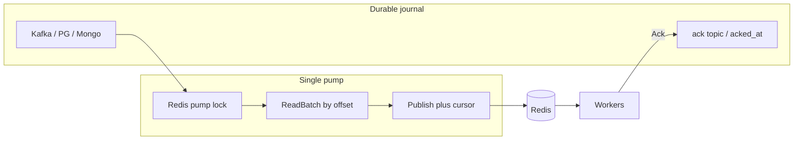
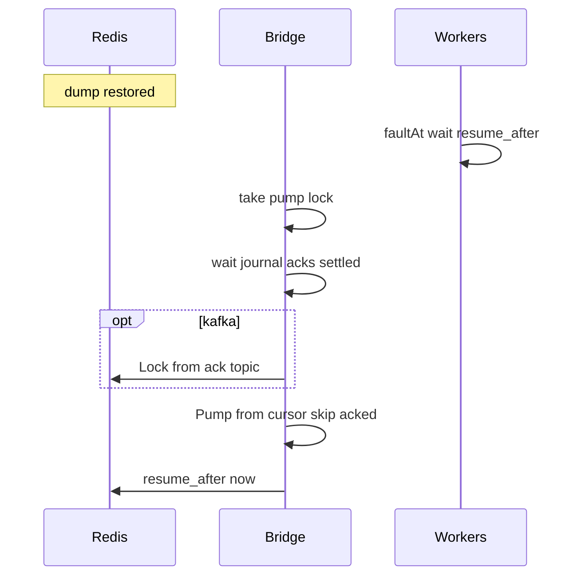

# Journal (durable ingress + recovery)

Журнал снаружи Redis — **источник правды о принятой работе**. Redis — планировщик (партиции, локи, RL). Драйверы — opt-in пакеты:

```text
github.com/Rinsvent/smart-redis-queue/journal
github.com/Rinsvent/smart-redis-queue/journal/kafka
github.com/Rinsvent/smart-redis-queue/journal/pg
github.com/Rinsvent/smart-redis-queue/journal/mongo
```

## Поток



1. Append в journal → монотонный **offset** (Kafka offset / `BIGSERIAL` / counter).
2. Один pump: Redis-lock → `ReadBatch(after offset)` → Publish в SRQ + cursor в Redis.
3. В источнике **не** флаг «прочитано». Только **ack** обработки.
4. После SRQ Ack: PG/Mongo `acked_at`; Kafka → ack-топик.

## Почему не курсор по `scheduled`

Два продюсера / долгая подготовка записи с `scheduled ≈ now`: более «поздний» батч может уехать в Redis раньше и сдвинуть time-курсор → опоздавшее сообщение **навсегда пропускается**.

Порядок между **разными** продюсерами в Redis тоже не гарантирован — только внутри одного упорядочивающего writer’а. Значит естественная ось журнала — **порядок append (offset)**, как в Kafka:

| Источник | Offset |
|----------|--------|
| kafka | partition offset |
| pg | `BIGSERIAL` / `GENERATED … AS IDENTITY` |
| mongo | атомарный counter (или аналог) |

Курсор в Redis: `srq:journal:{name}:cursor` = последний успешно опубликованный offset (с partition для kafka при необходимости).

### `scheduled` и far-future

- Нет планирования → `scheduled` пустой / nil → при insert = `now` (порядок = offset / taskId).
- Передали время **&lt; now** → **clamp к now**, чтобы due-фильтр не оставлял «вечно просроченный хвост» странным образом и не путал батчи.
- **Далекое будущее** не должно занимать «дыру» в offset-stream впереди due-сообщений: иначе pump упрётся в undued row или пропустит её. Модель: far schedule → **отдельная** scheduled-таблица/коллекция; mover, когда due, **вставляет в main journal** (новый offset) или качает SKIP LOCKED. Чистый Kafka far-schedule — limitation / dual store (pg).

Опционально multi-worker на due в PG: `FOR UPDATE SKIP LOCKED` + краткий claim — для **scheduled-mover**, не для hot offset-pump (pump один).

## Single-writer через Redis

Один pump на журнал для **всех** драйверов:

- ключ `srq:journal:{name}:pump` — `SET NX` + TTL ~60s;
- holder пингует / обновляет TTL ~каждые 10s (как heartbeat consumer’а);
- Redis ожил, ключа нет → любой инстанс журнала берёт лок и качает.

Kafka group по-прежнему полезна как доп. слой; источник истины «кто качает» — Redis-лок (одинаково для pg/mongo/kafka).

`Ack` — с любых инстансов без этого лока.

## Курсор и rewind

- Новый offset **строго больше** текущего → иначе `ErrJournalCursorRewind`.
- Publish батча + SET cursor — одна Lua (`jn`). Повтор тех же id → NX skip.

```text
ReadBatch WHERE offset > cursor [AND due] ORDER BY offset LIMIT n
→ PublishJournalBatch(..., lastOffset)
```

## Offset-ref в Redis

В payload очереди можно класть только ссылку на journal offset (экономия RAM). Handler:

```go
rec, err := src.ReadByOffset(ctx, offset)
// полный Task из journal
```

Как offset-ref в типичных dual-layer схемах: hot path в Redis лёгкий, body — в SoT.

## Схема PG

Имя таблицы: префикс **`srq_`** или полное имя в конфиге.

```sql
CREATE TABLE srq_journal_tasks (
    journal_offset BIGSERIAL PRIMARY KEY,
    task_id    TEXT NOT NULL UNIQUE,
    partition  TEXT NOT NULL DEFAULT '',
    priority   INT NOT NULL DEFAULT 0,
    payload    BYTEA NOT NULL,
    tags       TEXT[] NOT NULL DEFAULT '{}',
    groups     TEXT[] NOT NULL DEFAULT '{}',
    scheduled  TIMESTAMPTZ NOT NULL DEFAULT NOW(),
    created_at TIMESTAMPTZ NOT NULL DEFAULT NOW(),
    acked_at   TIMESTAMPTZ
);

CREATE INDEX idx_srq_journal_due
    ON srq_journal_tasks (scheduled)
    WHERE acked_at IS NULL;
```

Mongo: `journal_offset` (long) + unique `task_id`; counter collection для next offset.

## Ack

| | Done | Чистка |
|--|------|--------|
| pg/mongo | `acked_at` | TTL / job |
| kafka | ack-топик | retention |

Journal-ack после SRQ Ack — с ретраями до успеха.

## Recovery



- **PG/Mongo:** replay с offset-курсора, только `acked_at IS NULL` (Lock done-id не нужен).
- **Kafka:** Lock из ack-топика, затем replay с offset.
- **auto resume:** pump сам ставит `resume_after` после догона окна ~everysec; **manual** — админ.

## Окно потери

См. прежний разбор: journal закрывает приём + journal→Redis при everysec; between SRQ Ack и journal Ack — at-least-once. Прямой Publish в Redis journal не покрывает.

## API

```go
type Cursor struct {
    Offset    int64
    Partition int32 // kafka; 0 для pg/mongo
}

type Source interface {
    Init(ctx context.Context) error
    ReadBatch(ctx context.Context, after Cursor, n int) ([]Record, error)
    ReadByOffset(ctx context.Context, c Cursor) (Record, error)
    Ack(ctx context.Context, taskID string, meta map[string]string) error
    ReadAcks(ctx context.Context, from Cursor, n int) ([]AckEvent, error)
}

type Bridge interface {
    Pump(ctx context.Context, n int) (int, error)
    Loop(ctx context.Context, batch int, idle time.Duration) error
    RecoverAfterRedis(ctx context.Context, waitAcks func(context.Context) error) error
}
```

Pump lock — внутри `Bridge` (Redis), не обязанность драйвера.

## Инфра для тестов

`docker-compose`: Redis + Postgres + MongoDB + Kafka (KRaft). Интеграционные тесты драйверов — по доступности сервисов / env.

## См. также

- [delivery.md](../delivery.md#redis-persist) · [api.md](../reference/api.md) · [redis-keys.md](../reference/redis-keys.md)
