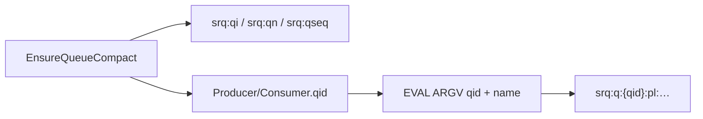

# Compact Redis keys — research / architecture (не реализовано)

Статус: **ресерч принят**, в бэклоге. Публично: [`ROADMAP.md`](../../ROADMAP.md) §13, [`docs/roadmap.md`](../../docs/roadmap.md).  
Текущие ключи: [`docs/reference/redis-keys.md`](../../docs/reference/redis-keys.md).

## Зачем

Redis держит key names в памяти. Длинные префиксы `queue:{queueName}:payload:…` размножаются на каждый meta-ключ задачи / партиции / consumer.

Цели:

1. Opt-in (сначала) короткий keyspace: `srq:q:{qid}:…` + короткие суффиксы.
2. В **major** — поведение по умолчанию + алгоритм миграции legacy → compact.
3. Без лишних remapping round-trip на hot path: Producer/Consumer знают `qid` после Ensure и передают в Lua ARGV.

Не цель этого эпика: сжатие payload (уже есть zstd), сжатие task id, interning партиций/групп/тегов (см. ниже).

## Исходная точка

- Каталог [`srq:queues`](../../queues_index.go): member = **имя** очереди, score = total. **Порядкового индекса нет** — `EnsureQueue` только `ZADD NX`.
- Данные: `queue:{name}:…` (~100 сборок в `scripts.go` + Admin/Go).
- Глобальные `srq:exchange:*`, `srq:journal:*`, `srq:tasks:*` уже под `srq:` — не трогаем.

## Режимы

| Режим | Ключи | Когда |
|-------|--------|--------|
| legacy (сейчас) | `queue:{name}:payload:{id}` | default до major |
| compact | `srq:q:{qid}:pl:{id}` | opt-in → в major default |

На одном `name` нельзя смешивать режимы: первый Ensure фиксирует режим (`srq:qmode` name→`legacy|compact`); повторный Ensure с другим режимом → ошибка.

## Meta-слой (compact)

| Ключ | Тип | Назначение |
|------|-----|------------|
| `srq:qseq` | STRING | `INCR` → следующий qid |
| `srq:qi` | HASH | `name → qid` |
| `srq:qn` | HASH | `qid → name` (Admin, reverse) |
| `srq:qmode` | HASH | `name → legacy\|compact` |
| `srq:queues` | ZSET | **контракт без изменений**: member = **имя**, score = total |

Ensure (compact):

1. `HGET srq:qi name` — если есть, вернуть qid.
2. Иначе `INCR srq:qseq`, `HSETNX srq:qi`, `HSET srq:qn`, выставить `qmode`, `ZADD NX srq:queues`.
3. Кэш на Producer/Consumer: `QueueRef{Name, QID, Compact}`.

API (эскиз): `WithCompactKeys()` на NewProducer / NewConsumer / pool. Gateway YAML — отдельным шагом.

В EVAL передаём **и** `qid`, **и** `queueName` (name нужен для `ZINCRBY srq:queues`). Remapping name→qid внутри Lua на hot path **не** делаем.

## Словарь суффиксов

| Legacy | Compact |
|--------|---------|
| `payload` | `pl` |
| `partition` (task→part meta) | `pm` |
| `priority` | `pp` |
| `qpriority` | `qp` |
| `tags` / `tag` | `tgs` / `tg` |
| `headers` | `hd` |
| `step` | `st` |
| `reject_count` | `rc` |
| `debounce` | `db` |
| `partitions` | `pts` |
| `priorities` | `pr` |
| `partition:` (lane) | `pt:` |
| `group:` / `groups` | `g:` / `gs` |
| `consumers` / `consumer:` | `cs` / `c:` |
| `blocked` | `bl` |
| `race:locks` / `race:tags` | `rlk` / `rt` |
| `shared` / `block` | `sh` / `bk` |
| `dlq` / `dlq:score` | `dl` / `dls` |
| `stats` / `stats:index` | `stt` / `sti` |
| `rl:g` / `rl:p` | `rg` / `rp` |
| `qp{N}:` lane prefix | `q{N}:` |

Префикс очереди: **`srq:q:{qid}:`**.

Пример: `queue:order-processing:payload:01HQ…` → `srq:q:42:pl:01HQ…`.

В Lua: helper `qk(qid, …)` + ARGV `mode` (или отдельные SCRIPT). Не дублировать весь Lua ×2 без нужды.

## Оценка экономии (имена ключей)

Допущения: queue=`order-processing` (16), task id ~26, ~10 meta-ключей на задачу.

| Что | Δ на 1 meta-ключ | 100k задач (~1M ключей) |
|-----|------------------|-------------------------|
| `queue:{name}:` → `srq:q:{qid}:` | ≈ −14…20 B | ~15–20 MB |
| short tokens (`payload`→`pl`, …) | ≈ −4…8 B | ~5–8 MB |
| **Итого** | | **~20–30 MB / 100k задач** |

Длинные имена очередей (40–80 B) — пропорционально больше. На 1M задач — порядок **200–300 MB** только key names (без учёта allocator overhead Redis). Values/payload не трогаем.

## Партиции / группы / теги — interning?

Сейчас строки part/group — и member ZSET/SET, и фрагмент имени ключа.

| Подход | Extra ops в Lua | Профит | Вердикт |
|--------|-----------------|--------|---------|
| Не трогать (только qid + short tokens) | 0 | основной выигрыш | **делаем** |
| Intern partition (`pi` HASH, members = числа) | HGET/HSETNX на новый part; Admin reverse | выигрыш при длинных UUID; иначе копейки | **откладываем** |
| Intern groups | то же | слабый (мало, короткие) | **нет** |
| Intern tags | то же | слабый / риск race-тегов | **нет** |

Команды Redis внутри Lua — без сетевого RTT, только CPU. Но: аллокация id, reverse map для Admin/CLI/тестов, усложнение Publish/Get/Reject/reclaim.

**Решение:** interning part/group/tag не делаем, пока профили (`MEMORY USAGE` / sample keys) не покажут доминирование длинных partition UUID.

## План изменений в коде (когда возьмём в работу)

1. `queues_index.go` — Ensure + resolve qid; `QueueRef`.
2. Producer/Consumer — option, кэш, ARGV.
3. `scripts.go` — key builder; ARGV compact + qid + name.
4. Admin — резолв имени → префикс через `srq:qi` / `qmode`.
5. Gateway — проброс опции (позже).
6. `docs/reference/redis-keys.md` + публичная feature-note.
7. Тесты: Publish/Get/Ack compact; fail mixed mode; каталог по имени.

## Major: default + миграция

Зафиксировано в roadmap:

1. Compact становится **default**.
2. Нужен **алгоритм перехода** `queue:{name}:…` → `srq:q:{qid}:…` (детализировать при реализации), ориентиры:
   - offline copy/rename под maintenance;
   - или dual-read окно + cutover + удаление legacy;
   - fail-closed, если оба формата частично заполнены.
3. До major: opt-in рядом с legacy.

## Итог

| Слой | Hot-path lookup | В скоупе |
|------|-----------------|----------|
| `srq:q:{qid}:` + short tokens | нет (qid с клиента) | **да** |
| QID в Ensure | 1–2 cmd при первом Ensure, далее кэш | **да** |
| Part/group/tag intern | да (alloc + reverse) | **нет** (низкий ROI) |
| Major migration | — | **да**, при major |
